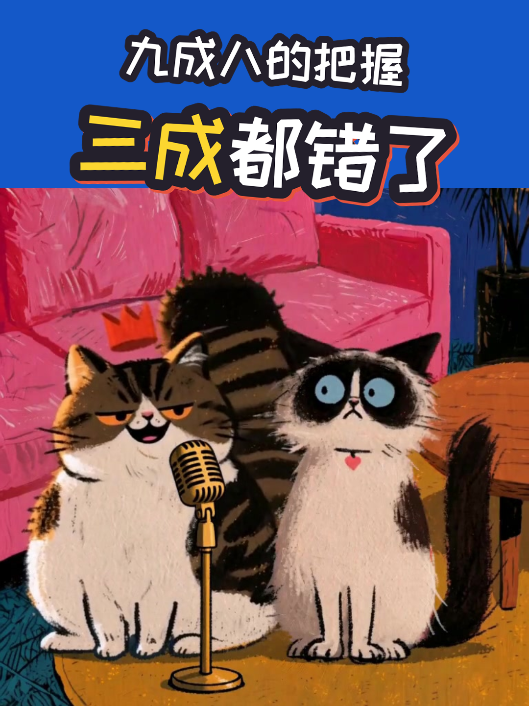
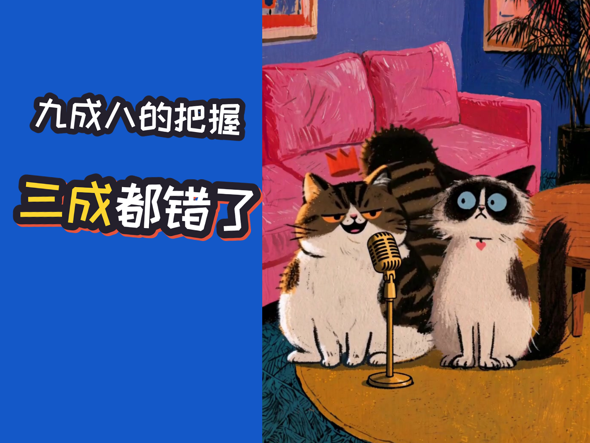

# 喵喵剧团 · 猫说社会心理学

一个 Claude Code skill：把迈尔斯《社会心理学》（第 11 版）里的一个概念或经典实验，做成三只猫（大比、胜利、大宝）情境演绎的竖屏科普短片，主要发抖音。

<p>


</p>

## 每一集是什么样

- **一个剧情 × 一个知识点 × 问题链**：一个场景里从头演到尾。每层结尾由一只猫说出观众心里的追问，下一层回答它，一共 3–4 层，约 70–90 秒。
- **全部情境演绎**：屏幕上只有台词字幕和名牌，没有图表和卡片。
- **画面**：三只猫是固定的 IP 造型（天真水粉插画风），用 LibTV 的海螺 H3 多参出镜头，镜头角度多变。
- **配音**：LibTV 的 Seed Audio 1.0，复刻每个角色固定的声音样本。会自动核字、比对声纹、剪掉句尾多说的部分。
- **交付四个文件**：成片、竖 3:4 封面、横 4:3 封面、抖音文案（标题、简介、置顶评论）。

样片：第 3 章「过度自信」（`assets/示例_v7_第3章过度自信_问题链/`）。客厅里的「九成八把握挑战」，四层问题链，89.8 秒。

## 安装

```sh
git clone git@github.com:ogen35/cat-social-psych.git ~/.claude/skills/cat-social-psych
```

然后在 Claude Code 里说「做第 6 章」「讲一下从众」「聚光灯效应来一期」就会触发。完整流程在 `SKILL.md`。

## 需要自己准备

- **`uv` 和 `ffmpeg`**。
- **LibTV 账号和 LibTV MCP**：用来出图、出 H3 镜头、配音，按 LibTV 计费。
  - 仓库里的节点 ID 属于原作者的 LibTV 项目，记在这几处：`assets/角色库/角色.json` 的 `libtv_voice`、`references/平涂画风.md` 第 1 节、`assets/平涂/场景库.json`、`scripts/flat_clips.py` 的 `PROJECT`。
  - 换成自己的项目时，要把三只猫的设定图（`assets/角色库/IP造型_v3/`）和声音样本（`assets/角色库/<角色>/声音样本.wav`）重新上传，再把这几处的 ID 换成新的。
- **书**：自备《社会心理学》第 11 版的 PDF，放进 `书籍/`。
  - 书受版权保护，不在仓库里。仓库里只有章节页码表 `书籍/book.json`。
  - 查书时在本地 OCR，不联网。

## 仓库里没有的

- `书籍/` 里的 PDF 和 OCR 文本；
- 各示例的中间文件 `build/`；
- 旧 Vox 样片的成片（125 MB，超过 GitHub 单文件上限）；
- 任何 API Key。豆包直连配音（备用）要自己的 Key，放在 `~/.config/cat-social-psych/keys.env`。

## 发布

发布到抖音、视频号、小红书时，在作品声明里勾选「内容由 AI 生成」。

## 致谢

`scripts/engine/` 里的旧版 Vox 片段提取自 huashu-art-motion（MIT，花叔），许可证见 `scripts/engine/LICENSE-huashu-art-motion`。
